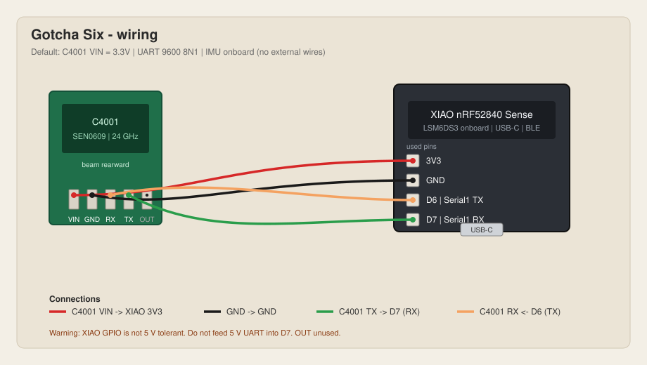

# Gotcha Six

Rear awareness for running, cycling, or any activity where you need to know what is behind you.

Hardware:

- Seeed Studio XIAO nRF52840 Sense
- DFRobot C4001 24 GHz mmWave radar (SEN0609)
- Onboard LSM6DS3TR-C IMU

The nRF52840 firmware is a transparent UART bridge plus an IMU feeder. Protocol parsing and motion interpretation live in a shared Rust core. The browser lab consumes that core over USB (Web Serial) or BLE (Web Bluetooth / Nordic UART Service).

## Repository layout

| Path | Role |
| --- | --- |
| `firmware/` | PlatformIO / Arduino dual-transport bridge |
| `core/` | Rust parser, tracking, detection (also WASM) |
| `lab/` | Vite TypeScript development console |

## Wiring



| C4001 | XIAO |
| --- | --- |
| TX | D7 (Serial1 RX) |
| RX | D6 (Serial1 TX) |
| GND | GND |
| VIN | **3.3V** |

The pin table is the source of truth. The diagram is a visual copy of that table.

XIAO GPIO is not 5 V tolerant. Do not feed 5 V UART into D7. The C4001 draws about 90 mA. If the 3.3 V rail browns out, power VIN from 5 V only after you measure TX at 3.3 V.

Radar Serial1: **9600 8N1**. USB CDC: **115200**. The C4001 datasheet also mentions 115200 in one place; this project keeps firmware at 9600 and does not send `setUart` from the device.

Mount the radar facing rearward. Beam is about 100° × 40°. Put the wide axis horizontal.

## Transports

- **USB CDC** and **BLE Nordic UART Service** run at the same time.
- Every radar UART byte is forwarded unmodified to USB and BLE.
- Host commands from USB or BLE are forwarded to the radar as complete lines (`\n`). If both have a complete line, **USB wins**. Incomplete lines never interleave. Lines over 128 bytes without `\n` are dropped.
- Firmware injects IMU samples as `$GSIMU,...*\r\n` on USB and BLE. Those lines are **not** sent to the radar UART.
- If BLE backpressure is high, firmware prefers to drop IMU samples and keep radar bytes.

BLE advertises as `Gotcha Six` with the standard NUS UUIDs.

## C4001 product mode

Speed/distance mode (`setRunApp 1`) reports `$DFDMD` (one target, distance, speed magnitude, energy). Presence mode (`setRunApp 0`) reports `$DFHPD` only; that is not the Gotcha Six default.

Default module max range is 6 m — too short for rear traffic. Use the lab **Gotcha Six preset**:

```
sensorStop
setRunApp 1
setRange 0.6 25
setMicroMotion 1
setThrFactor 5
setUartOutput 2 1 1 1
saveConfig
sensorStart
```

Wait ~3 s after power-up before configuring. Leave ~100 ms between commands. Confirm `$DFDMD` on hardware; if silent after `setRunApp 1`, check `setUartOutput`.

UART speed is a magnitude (about 0.1–10 m/s), not a signed closing rate. Approaching / receding is derived from distance change over time in the Rust core.

## IMU lines

```
$GSIMU,<ax>,<ay>,<az>,<gx>,<gy>,<gz>*\r\n
```

Accel is m/s². Gyro is rad/s. Rate is about 25 Hz. The Rust core parses these; it does not yet fuse IMU into threat logic.

## Build

### Firmware

```bash
pio run -d firmware
pio test -d firmware -e native
```

Board: `xiaoblesense_adafruit` (Adafruit nRF52 / Bluefruit), via the maxgerhardt PlatformIO nordicnrf52 fork.

Format check (needs `clang-format`):

```bash
find firmware/src firmware/test \( -name '*.cpp' -o -name '*.hpp' \) | xargs clang-format -i
find firmware/src firmware/test \( -name '*.cpp' -o -name '*.hpp' \) | xargs clang-format --dry-run --Werror
```

### Rust core

```bash
cargo fmt --all
cargo clippy --workspace --all-targets -- -D warnings
cargo test
```

### Lab (WASM + Vite)

```bash
cd lab && npm ci
npm run build:wasm
npm run format
npm run lint
npm test
npm run build
npm run dev
```

Live USB / BLE need Chromium (Web Serial / Web Bluetooth). Replay works without hardware.

## Format and lint

| Area | Tools |
| --- | --- |
| Rust | `rustfmt`, Clippy |
| Lab | Biome (`format` / `lint`) |
| Firmware | `clang-format` (LLVM-based style in `firmware/.clang-format`) |

CI runs format/lint checks before tests.

## Definition of done (Milestone 1–3)

1. Radar data arrives over UART and is forwarded on USB and BLE together.
2. Commands can be sent over either transport without silent byte interleaving.
3. USB keeps working while BLE is connected; BLE disconnect does not stop radar or USB.
4. `$GSIMU` appears on USB/BLE; radar `$DF*` bytes stay unmodified.
5. The lab displays, records, and replays data through the Rust/WASM engine.
6. Builds are reproducible with PlatformIO, Cargo, and npm.
