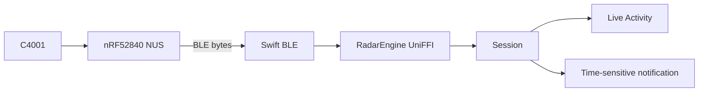

# Pocket session

**Path:** `docs/specs/2026-11-14-companion-app-design.md`  
**Author:** Josh McArthur (joshua.mcarthur@gmail.com)  
**Created:** 2026-11-14  
**Status:** Proposed  
**Repo:** [joshmcarthur/gotcha-six](https://github.com/joshmcarthur/gotcha-six)

## Related documents

- [Handoff for a new conversation](2026-11-14-companion-app-handoff.md)
- [Implementation plan](2026-11-14-companion-app-plan.md)

## Objective

Give a Gotcha Six wearer a small iPhone app that pairs over BLE, teaches what an approaching alert feels like, then stays out of the way as a Live Activity and an interrupt while they run or ride.

## Background

Gotcha Six is rear awareness hardware: a Seeed XIAO nRF52840 Sense and a DFRobot C4001 24 GHz radar, mounted facing backward. Firmware is a transparent UART bridge. Radar bytes and optional `$GSIMU` lines go out over USB CDC and BLE Nordic UART Service (NUS). Protocol parsing and approaching / receding live in `gotcha-six-core`. The browser lab already consumes that core over Web Serial or Web Bluetooth.

That lab is a debug console. It is not a pocket UI. A first Flutter companion (`nudge`, January 2026) used a custom GATT service, on-device detection, and IMU-adjacent assumptions. Gotcha Six does not speak that GATT. IMU samples are not reliable on current hardware, so the phone must not require them.

The wearer needs three things the lab does not provide: first-run teaching, a live radar check they can do alone, and a session that still works when the phone is locked.

## Goals

- A first-time wearer can pair a unit, feel a simulated approaching alert, and prove the radar with a solo step-back-to-wall check.
- During a session, the lock screen shows connection, motion, and distance. An approaching target interrupts without opening the app.
- Lab and phone share one parser and one radar preset. Detection does not fork.

## Non-goals

- Android, Flutter, Expo, or a revival of the Nudge GATT app.
- A Swift reimplementation of `$DFDMD` parsing.
- IMU mount checks, IMU fusion, or treating missing `$GSIMU` as an error.
- In-app charts, distance sliders, custom alert sounds, or headphone voice in v1.
- An Apple Watch app, widgets other than the session Live Activity, or accounts / cloud.

## Scenarios

**Scenario: First run**

1. The wearer opens the app. Welcome states that Gotcha Six watches behind them while they run or ride, and that it is an aid, not a substitute for looking.
2. They grant Bluetooth and notification permission.
3. A three-page how-to runs with no hardware: what the radar watches, a Play alert control that fires a haptic plus a sample Live Activity card, then a reminder that the phone stays in a pocket.
4. Find device lists peripherals named `Gotcha Six`. They tap one.
5. The app sends the shared radar preset, then opens Calibration.
6. Copy tells them to stand about 4–5 m from a wall, back to the wall, radar facing the wall. They tap Start and take two or three steps backward.
7. Distance falls and motion is `approaching`. The app confirms the radar saw the close. They continue to Home.

**Scenario: Everyday session**

1. Home auto-reconnects to the last peripheral id.
2. They tap Start session. A Live Activity begins. `RadarEngine` resets. NUS notifications stay on with `bluetooth-central` background mode.
3. They lock the phone. The Live Activity shows connection, a motion word, and distance in metres.
4. Something closes from behind. Motion is `approaching`. A time-sensitive local notification interrupts (banner + haptic). The Live Activity updates. They do not open the app.
5. They tap End session on Home (from the activity, or later). Alerts stop. BLE stays connected.

**Scenario: Solo calibration without a helper**

The radar faces rearward. A wall behind the wearer is a target. Stepping backward shrinks that distance. The core already reports that as approaching. No second person is required. No IMU is required.

**Scenario: Return visit**

Welcome, permissions, and how-to do not repeat. Home opens and reconnects. Overflow can replay the simulated how-to or run calibration again.

**Scenario: Link drop during a session**

The Live Activity shows Disconnected. One interrupt fires. The app reconnects to the stored id and resets the engine. The session stays on until End, or until the link stays down for five minutes.

## Diagrams

Editable source is the mermaid block above.

## Glossary

- **NUS:** Nordic UART Service. Firmware advertises as `Gotcha Six` with the standard NUS UUIDs. The lab already uses these.
- **RadarEngine:** `gotcha-six-core` type that parses bytes, tracks one target, and derives motion and closing speed.
- **Session:** The period from Start session to End session. Live Activity and alerts run only while a session is on.
- **Approaching:** Core motion when a present target’s distance has fallen by more than the stationary epsilon.

## Constraints

- iPhone only in v1. Live Activities and background BLE are native iOS APIs.
- Firmware is a byte bridge. The phone sends host command lines (`\n`). It does not get a custom detection characteristic.
- `$GSIMU` may be absent. Alerts and calibration use `$DFDMD` motion and distance only.
- ActivityKit will throttle high-rate updates. The session must not push every radar frame to the Live Activity.
- This spec is checked into `gotcha-six`. Xcode work needs a Mac; UniFFI tests can run on Linux CI.

## Interfaces

### UniFFI (`gotcha-six-core`)

Add a `uniffi` feature beside the existing `wasm` feature. Do not change `RadarEngine` behaviour. Expose:

- `new()`
- `push_bytes(data) -> [EngineOutput]`
- `reset()`
- the radar preset as an ordered list of command strings, plus the inter-command gap the lab uses today (~150 ms)

`EngineOutput` mirrors the lab WASM DTO enough for the phone: `kind`, `motion`, `distance_m`, `closing_speed_m_s`, `speed_m_s`, `energy`, `count`, `id`. IMU fields may appear on the DTO. The app ignores them for alerts and calibration.

Swift does not parse `$DFDMD`.

### BLE

- Scan and connect by advertised name `Gotcha Six` / NUS UUID `6e400001-b5a3-f393-e0a9-e50e24dcca9e`.
- Write command lines to NUS RX (`6e400002-…`), subscribe to NUS TX (`6e400003-…`).
- After first pair, store the Core Bluetooth peripheral id. Reconnect to that id. Forget device clears it and disconnects.
- After a fresh connect, send the preset (setup screen, and again if `$DFDMD` does not appear for a few seconds after reconnect — device likely rebooted).
- On disconnect or reconnect, call `reset()` on the engine so a stale distance cannot look like approaching.

### Screens

Five first-run screens, then one Home. A session does not open a new app screen. It changes Home and starts a Live Activity.

| Screen | Content | Controls |
| --- | --- | --- |
| Welcome | One sentence of purpose. One safety line. unDraw running illustration. | Continue |
| Permissions | Why Bluetooth and notifications. | Continue (system sheets). If denied: why it cannot work, open Settings. |
| How-to A | Radar faces backward. One target: distance and approaching / receding. Custom cone illustration. | Next |
| How-to B | “This is the alert for something closing from behind.” Sample Live Activity card (e.g. `Approaching · 12 m`). No extra illustration. | Play alert (haptic + sample card), Next |
| How-to C | During a session the phone stays in a pocket. Glance the Live Activity. unDraw phone-away illustration. | Next |
| Find device | “Turn the unit on. It advertises as Gotcha Six.” No illustration. | Device list, Retry. No skip. |
| Setting up radar | Automatic after connect. “Configuring the radar for rear range.” | Retry / Disconnect on failure |
| Calibration | Stand ~4–5 m from a wall, back to the wall. Tap Start, step backward toward the wall. Live distance and motion. Custom step-back illustration. | Start, I’m done, Try again, Skip for now |
| Home | Connection, calibration done/skipped, last distance if any. No charts. | Start session (needs BLE), Connect if down, overflow: Replay how-to, Recalibrate, Forget device |
| Home (session on) | “Session on”, live distance and motion. | End session |

Calibration **pass:** distance falls and motion is `approaching`, then a short confirmation.  
Calibration **fail:** timeout with no approaching. “No close-up on the wall. Check the radar faces backward, then try again.”  
Skip for now opens Home with calibration marked incomplete.

Live Activity (system): connection, motion word, distance in metres. Tap opens Home. No buttons on the activity in v1.

### Illustrations

Sparse. One drawing on teaching screens only. Home, scan, setup, permissions: text only. Replay how-to reuses the same three how-to assets. No art on the Live Activity.

- **unDraw** (one accent colour at download) for Welcome (running from behind) and How-to C (phone put away).
- **Custom SVGs** in the same flat style for How-to A (person, radar on the back, cone) and Calibration (person, back to a wall, one step backward). unDraw has no rear-radar scene.

One accent, shared with approaching emphasis. No second brand colour. No animation. No IMU drawings. No runner vs cyclist variants.

### Session and alerts

Start session requires an active BLE connection. It starts the Live Activity, resets the engine, and keeps NUS notify on.

Feed every notify payload into `push_bytes`. Use `kind`, `motion`, and `distance_m` only. Unknown and IMU outputs do not alert.

Live Activity updates on connection change, motion change, or a distance change of 0.5 m or more, and at most about once per second. No target → show `None`, not the last approaching distance.

An alert fires only when all of these are true:

- A session is on
- Latest target `motion` is `approaching`
- This is the first approaching in this close, **or** at least 2 seconds have passed **and** distance has fallen by at least 1 m since the last alert

Receding, stationary, lost, and unknown do not alert. v1 has one pattern and no distance slider.

Delivery: time-sensitive local notification (works locked). If Home is foreground, the app may also play the same haptic. No custom sound.

End session stops the Live Activity and alerts, and leaves BLE connected.

## Dependencies / infrastructure

- **Language:** Swift / SwiftUI for the app and ActivityKit extension. Rust for `gotcha-six-core` (already the parser).
- **Bindings:** UniFFI from `gotcha-six-core` into Swift. Same crate the lab uses via WASM.
- **BLE:** Core Bluetooth, `UIBackgroundModes` = `bluetooth-central`, restore identifier for the central manager.
- **Layout:** new `ios/` tree in this repo, next to `firmware/`, `core/`, and `lab/`.

## Security

The phone talks only to a user-chosen BLE peripheral. There is no account and no server. Trust boundary is the NUS pipe: untrusted bytes from the radio. The core must keep parsing bounded (it already caps lines at 512 bytes). Do not log raw streams in production builds.

Anyone in BLE range who knows the name can connect if the wearer is not already connected. v1 accepts that (same as the lab). Pairing/bonding is out of v1.

## Privacy

No location permission unless iOS later requires it for the BLE mode we actually use. No fitness account. No recording of sessions to disk in v1 (the lab’s export stays in the lab). Notification copy should not need a precise trail of GPS.

## Legal

Keep the safety line on Welcome: this is a supplement to looking, not a replacement. `gotcha-six-core` is MIT; the iOS app follows this repo’s licence. Do not pull Nudge (GPLv3) source.

## Open issues

**Accent colour**

Illustrations and approaching emphasis share one accent. Hex is not chosen.

- Options: pick at illustration implementation from a small set (amber alert vs teal).
- **Next step:** choose when adding the unDraw / custom SVGs, not in this spec.

**Preset-after-reconnect heuristic**

“No `$DFDMD` for a few seconds then send preset” is a guess that the module rebooted and lost RAM config. `saveConfig` is in the preset, so a sleep/wake may not need it.

- **Next step:** confirm on hardware during the first BLE slice; adjust the wait, do not add a settings toggle.

## Resolved issues

**Decision:** Native iPhone app in this repo, not Flutter/Nudge and not a Swift parser.  
Nudge’s GATT and on-device detection do not match Gotcha Six. A second parser would drift from the lab. UniFFI keeps one engine. Android waits.

**Decision:** IMU is absent from product logic.  
Current hardware has not produced usable IMU samples. Calibration is a step backward toward a wall. `$GSIMU` may still parse; the app does not require it.

**Decision:** How-to is simulated; calibration is live radar.  
Simulated Play alert teaches the haptic and the sample card without BLE. Calibration needs a connect and the preset. Skip for now exists so a missing wall cannot brick first run.

**Decision:** Time-sensitive notification is the locked-phone interrupt.  
In-app haptics are unreliable with the phone locked. The Live Activity is the glance UI, not the interrupt.

## Alternatives considered

- **Swift port of RadarEngine** — Fewer build tools. Two parsers. Rejected once the shared core was preferred.
- **UniFFI from day one vs later** — Extra Xcode/Rust glue. Chosen because lab fixtures and phone alerts must agree on approaching.
- **Revive Nudge Flutter** — Wrong protocol, IMU assumptions, custom GATT. Discarded.
- **Walk-behind with a helper** — Unnecessary. A wall plus a backward step is the same closing-distance signal.
- **Foreground-only haptic** — Fails the pocket/locked requirement.
