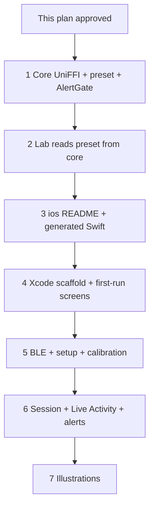

# Implementation plan: Pocket session companion app

**Path:** `docs/specs/2026-11-14-companion-app-plan.md`  
**Author:** Josh McArthur (joshua.mcarthur@gmail.com)  
**Created:** 2026-11-14  
**Status:** Proposed — do not write app code until this plan is approved  
**Design:** [`2026-11-14-companion-app-design.md`](2026-11-14-companion-app-design.md)

## Objective

Turn the approved v1 design into ordered slices. Keep one parser and one radar preset. Put iPhone UI in `ios/`. Do not parse `$DFDMD` in Swift.

## Gate

This document is the check-in. Wait for Josh to approve this PR before any UniFFI, Swift, or `ios/` code.

Linux CI can run core tests. Xcode project work needs a Mac. A Cloud Agent on Linux must not invent an `.xcodeproj`.

## Locked (do not reopen)

- Native iPhone / SwiftUI. No Android, Flutter, Expo, or Nudge GATT.
- Share `gotcha-six-core` through UniFFI. Firmware stays a byte bridge.
- App lives in `ios/` in this repo.
- BLE Nordic UART. Advertised name `Gotcha Six`. Same NUS UUIDs as `lab/src/transports/bluetooth.ts`.
- How-to is simulated. Calibration is a solo step-back-to-wall check. No helper. No IMU requirement.
- Missing `$GSIMU` is not an error.
- Session: Live Activity (glance) plus a time-sensitive local notification (interrupt). The phone may be locked.
- Art only on Welcome, How-to A, How-to C, and Calibration. One accent colour.

## Current code

| Piece | Today |
| --- | --- |
| `RadarEngine` | `core/src/lib.rs`. `push_bytes`, `reset`. No UniFFI. |
| WASM DTO | `core/src/wasm.rs` (`JsOutput`: `kind`, `motion`, `distance_m`, …). |
| Preset | `lab/src/preset.ts` only. Eight commands. Gap 150 ms. Lines end `\r\n`. |
| BLE | Lab Web Bluetooth. NUS `6e400001-…` / RX `6e400002-…` / TX `6e400003-…`. Write chunks of 20 bytes. |
| Motion | Distance fall greater than 0.05 m → `approaching`. UART speed is a magnitude. |
| Line cap | Parser drops a line at 512 bytes. |
| `ios/` | Absent. |
| CI | Ubuntu: `cargo test` (default features), lab WASM, firmware. No `--features uniffi`. |

Do not change `RadarEngine` behaviour. Add a UniFFI wrapper beside the WASM wrapper.

## Target tree (after all slices)

```
core/src/lib.rs              # wasm + uniffi features stay optional
core/src/wasm.rs             # unchanged role
core/src/uniffi_api.rs       # new: EngineOutput, RadarEngine, preset, AlertGate
core/src/preset.rs           # new: GOTCHA_SIX_PRESET + gap
lab/src/preset.ts            # re-export from WASM; do not keep a second list
ios/README.md                # Mac setup, cargo + Xcode
ios/GotchaSix/               # SwiftUI app (Mac slice)
ios/GotchaSixActivity/       # Live Activity extension (Mac slice)
ios/GotchaSixCore/           # generated Swift + headers (Linux can emit)
```

Firmware does not change in v1.

## Slice order



Slices 1–3 run on Linux CI. Slices 4–7 need a Mac (or a later macOS runner). Each slice is its own PR.

---

### Slice 1 — UniFFI feature, preset in core, alert gate

**Where:** `core/`  
**Machine:** Linux CI

**Preset**

Move the lab list into `core/src/preset.rs`:

```
sensorStop
setRunApp 1
setRange 0.6 25
setMicroMotion 1
setThrFactor 5
setUartOutput 2 1 1 1
saveConfig
sensorStart
```

Export:

- `gotcha_six_preset() -> Vec<String>` (ordered, exact strings above)
- `preset_command_gap_ms() -> u32` = `150`
- `encode_command_line(cmd) -> Vec<u8>` = trimmed command + `\r\n`

Add a Rust test that the list and the gap match those values. Do not add a settings toggle.

**UniFFI**

Add optional feature `uniffi` beside `wasm`. Do not enable both in one build.

- Crate types stay `cdylib` + `rlib`. iOS also needs `staticlib` when the Mac build starts (slice 4). Slice 1 can add `staticlib` now; it does not break Linux tests.
- New module `core/src/uniffi_api.rs`. Proc-macro UniFFI (0.29.x, compatible with Rust 1.89.0).
- Do not put UniFFI attributes on `RadarEngine` itself.

Wrapper (name `FfiRadarEngine` or `SharedRadarEngine`):

- `new()`
- `push_bytes(data: Vec<u8>) -> Vec<EngineOutput>`
- `reset()`

Hold the inner `RadarEngine` behind a `Mutex`. BLE callbacks can hop threads. Mutex is wrapper-only. Detection logic stays as today.

**`EngineOutput` record** (flat, same role as `JsOutput`):

| Field | Type | Notes |
| --- | --- | --- |
| `kind` | string | `target`, `presence`, `imu`, `unknown` |
| `motion` | string | `approaching`, `receding`, `stationary`, `lost`, `unknown` |
| `distance_m` | optional f32 | |
| `closing_speed_m_s` | optional f32 | |
| `speed_m_s` | optional f32 | |
| `energy` | optional u32 | |
| `count` | optional u8 | |
| `id` | optional u8 | |
| `raw` | string | Do not log in production iOS builds |
| IMU fields | optional | May appear. App ignores them for alerts and calibration. |

Swift must not parse `$DFDMD`. It only feeds bytes and reads this record.

**`AlertGate` (core, so Linux can lock the session rule)**

The design puts alert policy on the phone. Put the pure rule in core so it cannot drift:

An alert is allowed only when all of these hold:

1. `session_on` is true
2. Latest target `motion` is `approaching`
3. This is the first approaching in this close, **or** at least 2 s have passed **and** distance has fallen by at least 1 m since the last alert

Define a close as a run of `approaching`. Any other motion (`receding`, `stationary`, `lost`, `unknown`) ends the close. Receding, stationary, lost, unknown, IMU, and presence do not alert.

`AlertGate` is a small state machine: `observe(session_on, kind, motion, distance_m, now_ms) -> bool`. Call `reset()` when a session starts or the engine resets on reconnect.

Tests (new, fixture-friendly):

- First approaching in a close → fire
- Second approaching 0.5 s later, 0.2 m closer → no fire
- Approaching again after 2 s and ≥ 1 m closer → fire
- Receding then approaching → fire again (new close)
- `session_on == false` → never fire
- `kind == imu` → never fire
- Lost → no fire; next approaching is a new close

Do not push this gate into the lab UI.

**CI**

`.github/workflows/ci.yml` core job: also `cargo clippy` and `cargo test` with `--features uniffi`. Keep the default-feature run. Do not add Apple targets to Ubuntu.

**Done when:** `cargo test --features uniffi` is green on Linux. `RadarEngine` tests still pass. Preset strings are in core.

---

### Slice 2 — Lab consumes the core preset

**Where:** `core/src/wasm.rs`, `lab/src/preset.ts`  
**Machine:** Linux CI

WASM exports the same preset list, gap, and `encode_command_line`. `lab/src/preset.ts` becomes a thin wrapper over those exports. `sendPreset` stays in TypeScript (async gap). Lab tests still check `setRunApp 1`, `setRange 0.6 25`, and CRLF encoding.

**Done when:** lab tests pass. There is one source list: the Rust constants.

---

### Slice 3 — `ios/` bindings scaffold (no Xcode project)

**Where:** `ios/`  
**Machine:** Linux can generate Swift; it cannot compile for iOS

Add:

- `ios/README.md`: rustup targets `aarch64-apple-ios` and `aarch64-apple-ios-sim` (Mac), UniFFI generate command, Xcode open path, signing note.
- Generate Swift + C headers into `ios/GotchaSixCore/` from the `uniffi` feature. Check the generated Swift in so a Mac does not need to reverse-engineer the API.
- `.gitignore`: `xcuserdata`, `DerivedData`, `*.xcuserstate`. Do not ignore the generated Swift.

Do not add a fake `project.pbxproj`. Do not add compiled `.a` / XCFramework blobs.

**Done when:** generated Swift shows `FfiRadarEngine`, preset helpers, and `AlertGate`. Linux CI may run the generate step as a check if it stays cheap; it must not try to compile Apple targets.

---

### Slice 4 — Xcode scaffold and first-run screens

**Where:** `ios/`  
**Machine:** Mac required

Create the Xcode project on a Mac:

- App target `GotchaSix`
- Widget extension `GotchaSixActivity` (empty surface until slice 6)
- iOS **17.0** minimum (Live Activities + time-sensitive APIs without extra `#available` noise)
- Bundle id: open issue (placeholder `nz.mcarthur.GotchaSix` until Josh sets the team prefix)
- SwiftUI, one `WindowGroup`
- Link the UniFFI static lib via an Xcode build phase that runs `cargo build --features uniffi` for the active Apple target

Capabilities and plist (can be present before they are used):

- `UIBackgroundModes` = `bluetooth-central`
- `NSSupportsLiveActivities` = `YES`
- `NSBluetoothAlwaysUsageDescription` — pair a Gotcha Six unit over Bluetooth
- Notification permission copy — interrupt when something closes from behind
- Time-sensitive entitlement on the app target (needed in slice 6)

**Navigation**

`AppStorage` / `UserDefaults`:

| Key | Meaning |
| --- | --- |
| `hasCompletedHowTo` | Welcome + permissions + how-to finished |
| `peripheralId` | Last Core Bluetooth UUID string |
| `calibrationState` | `done` / `skipped` / unset |

First launch: Welcome → Permissions → How-to A → B → C → Find device.  
Return visit: Home. Overflow can replay how-to (same three pages).

**Screens (copy from the design table; no extra chrome)**

| Screen | Behaviour in this slice |
| --- | --- |
| Welcome | Purpose sentence. Safety line: aid, not a substitute for looking. Illustration slot (empty until slice 7). Continue. |
| Permissions | Why Bluetooth and notifications. Continue requests both system sheets. If denied: short fail copy + Open Settings. |
| How-to A | Radar faces backward. One target: distance and approaching / receding. Illustration slot. Next. |
| How-to B | “This is the alert for something closing from behind.” Sample Live Activity **card in-app** (`Approaching · 12 m`). Play alert: same haptic as a real alert. No extra illustration. Next. |
| How-to C | Phone stays in a pocket. Glance the Live Activity. Illustration slot. Next. |
| Find device | Copy + empty list + Retry. No skip. No illustration. (Live scan is slice 5.) |
| Home | Connection unknown / not connected. Overflow: Replay how-to. Start session disabled without BLE. No illustration. |

Use system fonts. One accent colour token in the asset catalog. Hex stays open until slice 7. No charts. No distance slider. No second brand colour.

**Done when:** a Mac simulator shows Welcome through How-to and Home with `hasCompletedHowTo`. Play alert fires a haptic and flashes the sample card. No BLE yet.

---

### Slice 5 — BLE, setup, calibration

**Where:** `ios/GotchaSix`  
**Machine:** Mac + hardware to confirm; simulator can show the UI

**NUS (copy from the lab, do not invent)**

| Role | UUID |
| --- | --- |
| Service | `6e400001-b5a3-f393-e0a9-e50e24dcca9e` |
| RX (phone writes) | `6e400002-b5a3-f393-e0a9-e50e24dcca9e` |
| TX (device notifies) | `6e400003-b5a3-f393-e0a9-e50e24dcca9e` |

Scan and connect by advertised name `Gotcha Six` and/or the NUS service UUID. Store the peripheral UUID after first pair. Reconnect to that id on Home. Forget device clears the id, disconnects, and returns to Find device.

`CBCentralManager` restore identifier: `gotcha-six-central`.

Write command lines in 20-byte chunks without response, same as the lab. Subscribe to TX notifications. Feed **every** notify payload into `push_bytes`. Do not parse lines in Swift.

On disconnect or reconnect: `FfiRadarEngine.reset()` and `AlertGate.reset()` so a stale distance cannot look like approaching.

**Setting up radar**

Automatic after a fresh connect.

1. Short wait after GATT is ready (start at **1 s**; README also says wait ~3 s after power-up — confirm on hardware).
2. Send the core preset with `preset_command_gap_ms` between commands.
3. Show “Configuring the radar for rear range.”
4. Failure: Retry / Disconnect.

After reconnect: if no `kind == target` (`$DFDMD`) for **4 s**, send the preset again (device likely rebooted). `saveConfig` is in the preset, so a sleep/wake may not need this. Confirm on hardware. Adjust the wait. Do not add a settings toggle.

**Calibration**

Live radar. Copy: stand about 4–5 m from a wall, back to the wall, radar facing the wall. Tap Start. Take two or three steps backward.

- Use `kind`, `motion`, and `distance_m` only.
- **Pass:** distance falls and motion is `approaching`, then a short confirmation. Continue to Home. `calibrationState = done`.
- **Fail:** **20 s** timeout with no approaching. “No close-up on the wall. Check the radar faces backward, then try again.”
- Controls: Start, I’m done, Try again, Skip for now.
- Skip for now → Home with calibration incomplete.

Home: connection, calibration done/skipped, last distance if any. Connect if down. Overflow: Replay how-to, Recalibrate, Forget device.

**Done when:** a real unit named `Gotcha Six` pairs, takes the preset, and a solo step-back produces approaching. Simulator still runs how-to with no hardware.

---

### Slice 6 — Session, Live Activity, alerts

**Where:** app + `GotchaSixActivity`  
**Machine:** Mac; lock-screen checks need a device

**Start session** (Home, requires an active BLE connection)

- Set session on.
- `FfiRadarEngine.reset()` and `AlertGate.reset()`.
- Start the Live Activity.
- Keep NUS notify on. `bluetooth-central` must already be set.

A session does not open a new app screen. Home shows “Session on”, live distance and motion, End session.

**Live Activity (glance only)**

Fields: connection (`Connected` / `Disconnected`), motion word, distance in metres. No art. No buttons. Tap opens Home.

Update when any of these is true, and **at most about once per second**:

- connection changed
- motion changed
- distance changed by **0.5 m** or more

No target → show `None`, not the last approaching distance. ActivityKit will throttle high-rate updates. Do not push every radar frame.

**Alerts (interrupt)**

Feed each `EngineOutput` through `AlertGate`. On `true`:

- Post a **time-sensitive** local notification (banner + default haptic). Copy names approaching and the distance if present, e.g. `Approaching · 12 m`. No custom sound. No GPS.
- If Home is foreground, also play the same haptic as How-to B.

One pattern in v1. No distance slider. Receding / stationary / lost / unknown / IMU do not alert.

**End session**

Stop the Live Activity and alerts. Leave BLE connected.

**Link drop during a session**

- Live Activity shows Disconnected.
- One interrupt fires (not an approaching alert: a disconnect notice).
- Reconnect to the stored id. Reset engine and gate.
- Session stays on until End, or until the link stays down for **five minutes** — then end the session.

**Done when:** lock the phone, keep the session, and an approaching target interrupts. The Live Activity shows connection, motion, and distance. End session stops alerts.

---

### Slice 7 — Illustrations

**Where:** teaching screens only  
**Machine:** any; visual check on a phone or simulator

Sparse. One drawing per teaching screen. Home, Find device, Setting up, Permissions, Live Activity: text only. Replay how-to reuses the same three how-to assets.

| Screen | Asset |
| --- | --- |
| Welcome | unDraw, running / viewed from behind |
| How-to A | Custom SVG: person, radar on the back, rear cone |
| How-to C | unDraw, phone put away |
| Calibration | Custom SVG: person, back to a wall, one step backward |

Rules:

- One accent, shared with approaching emphasis. Pick hex here from a small set: lab teal `#3d9b6e` vs an amber alert. Write the chosen hex in this spec’s follow-up or in `ios/README.md`.
- unDraw download uses that accent. Keep the unDraw licence notice next to the files.
- Custom SVGs match unDraw’s flat style (simple geometry, no outlines-as-texture, no faces of real people).
- No animation. No IMU drawings. No runner vs cyclist variants.
- How-to B stays the sample Live Activity card only.

**Done when:** Welcome, How-to A, How-to C, and Calibration each show one drawing. Other screens stay text.

---

## BLE constants (single copy in Swift)

```
NUS_SERVICE = 6E400001-B5A3-F393-E0A9-E50E24DCCA9E
NUS_RX      = 6E400002-B5A3-F393-E0A9-E50E24DCCA9E
NUS_TX      = 6E400003-B5A3-F393-E0A9-E50E24DCCA9E
NAME        = Gotcha Six
WRITE_CHUNK = 20
```

Do not add a second GATT service. Do not revive Nudge characteristics.

## Tests

| Layer | What |
| --- | --- |
| Core (Linux) | Existing fixtures stay. New preset snapshot. New `AlertGate` cases. UniFFI types compile under `--features uniffi`. |
| Lab (Linux) | Preset tests still pass after the list moves to core. |
| iOS | How-to haptic on simulator. Calibration + session on a device. No BLE fake in CI for v1. |
| Firmware | Untouched. |

Use `core/tests/fixtures/session_approach.txt` as the approaching story: distance 20 → 10 m, then a `$GSIMU` line, then no target. Phone logic must treat the IMU line as non-alerting.

## Security and privacy (implementation)

- Trust boundary is the NUS pipe. Core already caps lines at 512 bytes. Keep that.
- Do not log raw streams in production (`#if DEBUG` only, if at all).
- No account, no server, no session recording to disk in v1.
- No location permission unless iOS later requires it for the BLE mode we actually use.
- Anyone in range who knows the name can connect if the wearer is not already connected. v1 accepts that (same as the lab). No bonding.
- Do not pull Nudge (GPLv3) source. `gotcha-six-core` is MIT. The iOS app follows this repo’s licence.

## README

When slice 3 lands, add `ios/` to the repository layout table. When slice 4 lands, add a short “iPhone companion” build note (Xcode + Rust toolchain). Do not promise Android.

## Open issues (still open from the design)

**Accent colour** — pick in slice 7. Candidates: `#3d9b6e` (lab) or amber.

**Preset-after-reconnect wait** — start at 4 s with no `target` output; confirm on hardware in slice 5.

**Bundle id / Apple team** — Josh sets signing. Placeholder `nz.mcarthur.GotchaSix`. Time-sensitive notifications need the entitlement on the developer account.

**Calibration timeout** — 20 s in this plan. Change only if hardware shows it is too short or too long.

## Risks

| Risk | Mitigation |
| --- | --- |
| ActivityKit drops fast updates | Cap at ~1 Hz and the 0.5 m / motion / connection rule. |
| iOS suspends BLE | `bluetooth-central` + central restore + reconnect to stored id. |
| Time-sensitive entitlement missing | Session still updates the Live Activity; interrupt will be weak. Flag in slice 6 if signing blocks it. |
| UniFFI + WASM in one crate | Separate features. CI runs them apart. |
| No Mac on the current agent | Stop after slice 3 until a Mac is available. |
| Stale distance after reconnect | Always `reset()` engine and gate. |

## Alternatives rejected (again)

- Swift port of `RadarEngine`
- Reviving Nudge Flutter
- Walk-behind with a helper
- Foreground-only haptic
- Settings UI for preset-after-reconnect

## Definition of done (v1 app)

1. First-time wearer completes Welcome, permissions, simulated how-to, pair, preset, and wall-step calibration (or skip).
2. Home reconnects to the last peripheral.
3. Start session shows a Live Activity. An approaching target interrupts on a locked phone.
4. Lab and phone share one `RadarEngine` and one preset list.
5. No Swift `$DFDMD` parser. No IMU required. No Nudge GATT.
6. Slices 1–2 stay green on Linux CI.

## Next action after approval

Start slice 1 on this repo (Linux). Do not open Xcode work until a Mac is in the loop.
